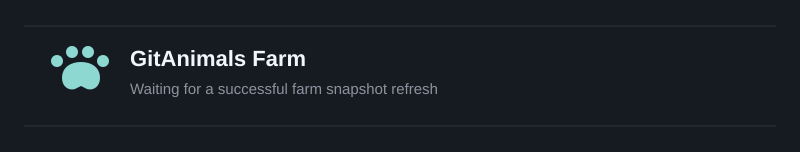

# guseoh

**Java · Spring Backend Developer**

Java와 Spring을 중심으로 백엔드 개발과 시스템 설계를 공부하고 있습니다.  
문제를 재현하고, 코드와 테스트·측정 결과를 바탕으로 개선하는 과정을 중요하게 생각합니다.

---

## About

Java·Spring을 기반으로 백엔드 시스템을 개발하면서 기능이 동작하는 이유와 설계 선택의 근거를 이해하고자 합니다. 구현한 내용을 테스트·측정·운영 관점에서 확인하고, 그 과정에서 배운 내용을 프로젝트와 기술 블로그에 기록합니다.

## Current Focus

**Software Design** · 요구사항, 도메인 모델링, API·데이터 모델과 Trade-off

**AI-assisted Development** · ChatGPT·Codex를 활용한 구현, 코드 리뷰, 검증 워크플로

**Reliability & Operations** · 데이터 정합성, 성능 측정, 관측과 장애 대응

## Tech Stack

**Backend & Spring**

  
  
  
  
  
  
  
  

**Database & Persistence**

  
  
  
  

**Infrastructure & Observability**

  
  
  
  
  
  
  
  

**Web & Development Tools**

  
  
  
  

---

## Projects

### Featured Project

#### [PawCycle Commerce](https://github.com/guseoh/pawcycle-commerce)

COMMERCE / SUBSCRIPTION · JAVA / SPRING

반려동물 소모품의 일반 구매와 정기배송을 구현하는 커머스 프로젝트입니다. 구매·구독 흐름뿐 아니라 멱등성, 구독 단위 트랜잭션 격리, SQL 조회 성능을 실제 문제와 검증 결과를 바탕으로 개선하고 있습니다.

**핵심 경험** · 정기배송 생명주기 설계 · 중복 요청 방지 · 실패 격리 · N+1 측정 및 개선

**기술** · Java · Spring Boot · Spring Security · JPA · MySQL · Flyway · Next.js · Docker

[Repository](https://github.com/guseoh/pawcycle-commerce) · [설계 및 검증 기록](https://github.com/guseoh/pawcycle-commerce#readme)

### Learning Projects

#### [CSForge](https://github.com/guseoh/csforge)

BACKEND / CS LEARNING PLATFORM

Java·Spring·CS 개념을 체계적으로 학습하기 위해 만든 플랫폼입니다. 개념·문항·학습 이력을 연결하고, 콘텐츠를 가져오거나 동기화할 때 기존 학습 데이터를 보호하는 흐름도 구현했습니다.

**핵심 경험** · 학습 콘텐츠 모델링 · Preview / Diff / Confirm · 반복 가능한 데이터 동기화 · 학습 이력 보호

**기술** · Java · Spring Boot · PostgreSQL · Redis · React · TypeScript

[Repository](https://github.com/guseoh/csforge) · [Live Demo](https://csforge-five.vercel.app/)

#### [Dark Todo Planner](https://github.com/guseoh/dark-todo-planner)

PERSONAL PRODUCTIVITY / WEB APPLICATION

할 일·캘린더·프로젝트·메모를 하나의 흐름으로 관리하는 개인용 웹 앱입니다. 사용 경험을 개선하면서 Cloudflare 기반 배포, 브라우저 테스트, 백업·복원까지 개발 전반을 다루고 있습니다.

**핵심 경험** · 월간·주간 캘린더 · 프로젝트 Kanban · WYSIWYG 메모 · E2E 검증 · D1 데이터 백업

**기술** · React · TypeScript · Hono · Cloudflare Workers · D1 · GitHub Actions

[Repository](https://github.com/guseoh/dark-todo-planner) · [Live Demo](https://dark-todo-planner.guseoh.workers.dev/)

---

## GitAnimals

매일 최신 농장 이미지로 갱신합니다. 서비스에 연결되지 않을 때는 마지막으로 저장한 이미지를 유지합니다.

<a href="https://render.gitanimals.org/farms/guseoh">실시간 Farm 보기</a>

---

## Latest Blog Posts

Java·Spring·JPA·HTTP·인프라 관련 학습과 검증 과정을 [기술 블로그](https://guseoh.github.io/)에 정리하고 있습니다.

<!-- BLOG-POST-LIST:START -->

<a href="https://guseoh.github.io/blog/jpa/persistence-context/">JPA 영속성 컨텍스트: 엔티티는 어떻게 관리될까?</a>

<a href="https://guseoh.github.io/blog/jpa/relationship-mapping/">JPA 연관관계 매핑: 객체 참조와 외래 키</a>

<a href="https://guseoh.github.io/blog/security/basic3/">Spring Security는 무엇을 해결할까?</a>

<!-- BLOG-POST-LIST:END -->

[전체 글 보기](https://guseoh.github.io/blog/)
