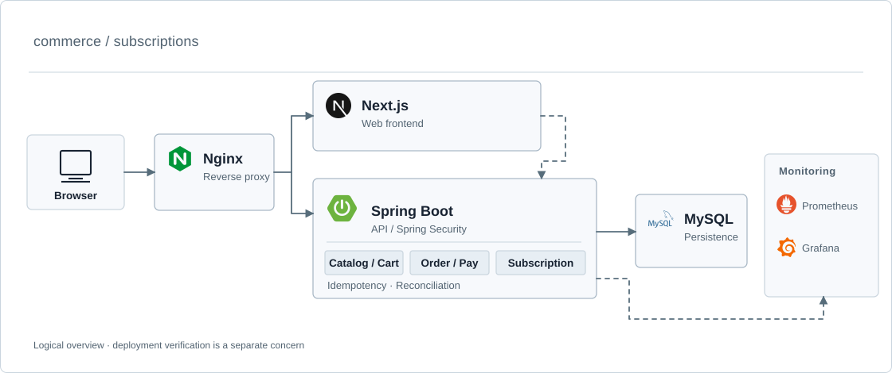
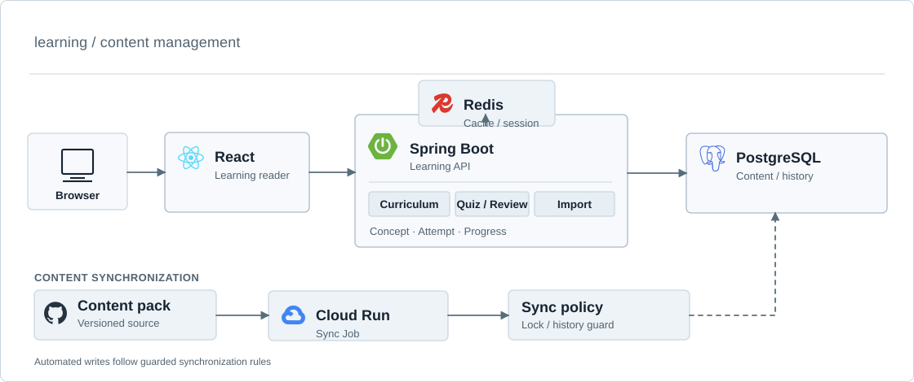
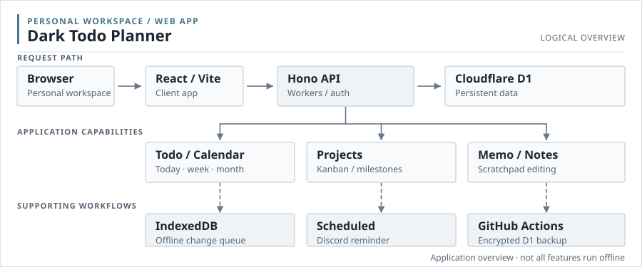

# guseoh

**Java · Spring Backend Developer**

Java와 Spring으로 백엔드 시스템을 만들고, 설계한 내용을 코드와 데이터로 검증합니다.  
배운 것은 프로젝트와 글로 남기고 있습니다.

---

## About

요구사항을 도메인과 API로 풀어내는 설계 과정에 관심이 있습니다. 기능 구현 이후에는 트랜잭션, 데이터 정합성, 성능, 장애 상황을 재현하고 확인하는 것을 중요하게 생각합니다.

> **Current Focus** · Software Design / AI-assisted Development / Reliability

---

## Projects

<strong>PawCycle Commerce</strong> — 반려동물 소모품 구매와 정기배송

 

정기배송의 전체 흐름을 구현하면서 데이터 정합성과 운영 안정성을 검증하는 커머스 프로젝트입니다. 상품 구매·구독 변경·배송 일정 관리부터 멱등성, 구독별 트랜잭션 실패 격리, N+1 측정 및 개선까지 다루고 있습니다.

  <picture>
    <source media="(prefers-color-scheme: dark)" srcset="./assets/architecture/pawcycle-dark.svg" />
    <source media="(prefers-color-scheme: light)" srcset="./assets/architecture/pawcycle-light.svg" />
    
  </picture>

[Repository](https://github.com/guseoh/pawcycle-commerce) · [설계·검증 기록](https://github.com/guseoh/pawcycle-commerce#readme)

<strong>CSForge</strong> — CS 개념 및 학습 이력 관리 플랫폼

 

Java·Spring·CS 개념을 영역과 주제별로 구조화하고 학습 기록과 연결한 플랫폼입니다. 콘텐츠를 반복해서 가져오거나 동기화할 때 기존 학습 데이터를 보호하는 흐름도 구현했습니다.

  <picture>
    <source media="(prefers-color-scheme: dark)" srcset="./assets/architecture/csforge-dark.svg" />
    <source media="(prefers-color-scheme: light)" srcset="./assets/architecture/csforge-light.svg" />
    
  </picture>

[Repository](https://github.com/guseoh/csforge) · [Live Demo](https://csforge-five.vercel.app/)

<strong>Dark Todo Planner</strong> — 일정·프로젝트·메모 통합 플래너

 

할 일·월간/주간 캘린더·프로젝트 Kanban·메모를 연결한 개인 작업 관리 웹 앱입니다. 사용 경험을 개선하면서 E2E 테스트, Cloudflare D1 백업 및 배포 자동화를 구성했습니다.

  <picture>
    <source media="(prefers-color-scheme: dark)" srcset="./assets/architecture/dark-todo-dark.svg" />
    <source media="(prefers-color-scheme: light)" srcset="./assets/architecture/dark-todo-light.svg" />
    
  </picture>

[Repository](https://github.com/guseoh/dark-todo-planner) · [Live Demo](https://dark-todo-planner.guseoh.workers.dev/)

---

## Tech Stack

**Backend & Spring**

  
  
  
  
  
  
  
  

**Database & Persistence**

  
  
  
  

**Infrastructure & Observability**

  
  
  
  
  
  
  
  

**Web & Development Tools**

  
  
  
  

---

## Latest Blog Posts

<!-- BLOG-POST-LIST:START -->

01 &emsp; <a href="https://guseoh.github.io/blog/jpa/persistence-context/">JPA 영속성 컨텍스트: 엔티티는 어떻게 관리될까?</a>

02 &emsp; <a href="https://guseoh.github.io/blog/jpa/relationship-mapping/">JPA 연관관계 매핑: 객체 참조와 외래 키</a>

03 &emsp; <a href="https://guseoh.github.io/blog/security/basic3/">Spring Security는 무엇을 해결할까?</a>

<!-- BLOG-POST-LIST:END -->

<a href="https://guseoh.github.io/blog/">모든 글 보기</a>

---

## GitAnimals

